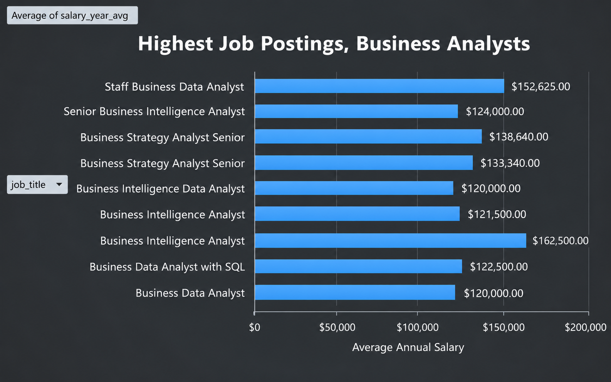
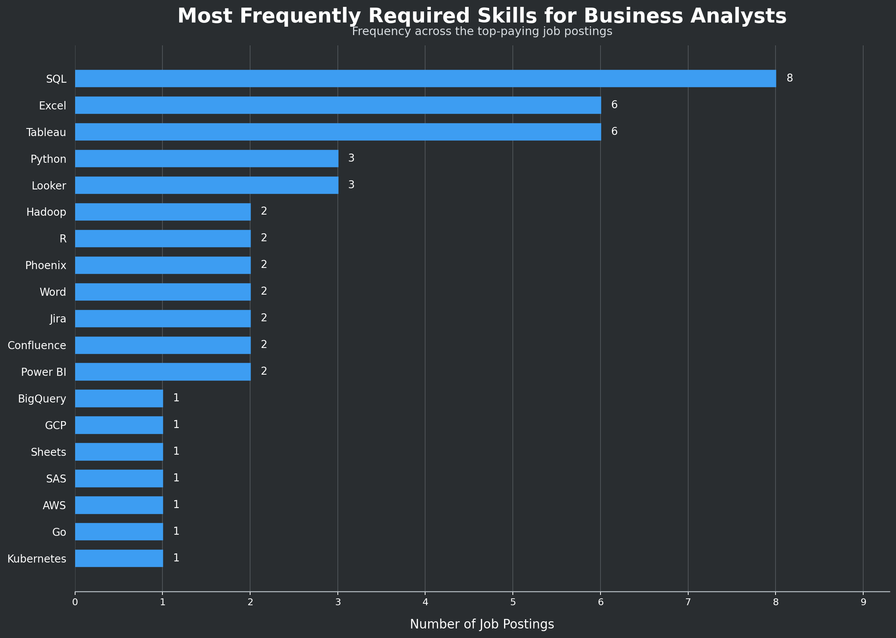
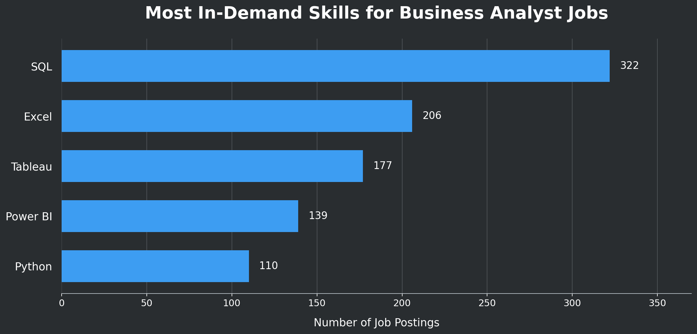
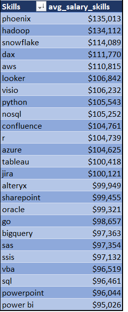
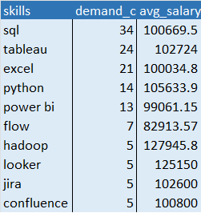

# Introduction 
Explore the job market specifically for Business Analysts! 
This project explores the top-paying jobs, the most in-demand
skills, and the skills that lead to the highest paying jobs for Business Analysts.

[project_sql_folder](/SQL_PROJECT_DATA_JOBS/project_sql/)

# Background 
Driven by personal interest in the job market and necessary skills needed for Business Analysts, this project pinpoints the top-paid and in-demand skills necessary, giving guidance for others interested in the field.

The data for this analysis is from [Luke Barousse's SQL course](/https://sql.lukebarousse.com/#/workspace?hide_schema=1)

The questions answered through the SQL queries were:

    1. What are the top paying Business Analysts jobs?
    2. What skills are required for these top paying jobs?
    3. What skills are most in demand for Business Analysts?
    4. Which skills are associated with higher salaries?
    5. What are the most optimal skills to learn

### Tools I Used

In this project, I utilized a variety of tools to conduct my analysis:

- **SQL** (Structured Query Language): Enabled me to interact with the database, extract insights, and answer my key questions through queries.
- **PostgreSQL**: As the database management system, PostgreSQL allowed me to store, query, and manipulate the job posting data.
- **Visual Studio Code:** This open-source administration and development platform helped me manage the database and execute SQL queries.


## Analysis

Each query for this project aimed at investigating specific aspects of the Business Analyst job market. Here’s how I approached each question:

#### 1. Top Paying Jobs
 This query is to identify the highest-paying roles for Business Analysts. Business Analyst positions are filtered by salary and location, focusing on remote jobs. This query highlights the high paying opportunities in the field.
   
   

``` 
            job_postings_fact
        LEFT JOIN company_dim ON
        job_postings_fact.company_id=company_dim.company_id

        WHERE
            job_location ='Anywhere' 
        AND
            job_title  Ilike '%Business%Analyst%'
  ' 
        AND
            salary_year_avg is not NULL

        ORDER BY salary_year_avg DESC
            limit 10
```

### Findings from analysis 
- The top highest paying jobs for Business Analysts that work remotely is $162,500
- Jobs that mention niche titles such as **"Intelligence" or "Strategy"** make up the majority of the top 10 highest paid Business Analyst positions indicating that specialization may increase earnings
- Wide range of industries recruiting Business Analysts. From finance, insurance, consulting, and information Technology indicating a broad demand

## Top Business Analyst Salaries


*graph created via pivot charts on excel


  
---
#### 2. Top Paying Job Skills 
This query answers what the top paying necessary skills for Business Analysts are. 


``` WITH top_paying_jobs AS (
    SELECT  
        --company_dim.name as company_name,
        job_id,
        job_title,
        salary_year_avg,
        job_location

    FROM
        job_postings_fact
    --LEFT JOIN company_dim ON job_postings_fact.company_id=company_dim.company_id
    WHERE
    job_location ='Anywhere' 
    AND
        job_title  Ilike '%Business%Analyst%' 
    AND
        salary_year_avg is not NULL

    ORDER BY salary_year_avg DESC
    limit 10
)
select 
        top_paying_jobs.job_id,
        job_title,
        salary_year_avg,
        skills
       
FROM
    top_paying_jobs 
	INNER JOIN
    skills_job_dim ON top_paying_jobs.job_id = skills_job_dim.job_id
	INNER JOIN
    skills_dim ON skills_job_dim.skill_id = skills_dim.skill_id

ORDER BY 
    salary_year_avg DESC

```
### Findings from Analysis
  - **The highest salaried job postings for Business Analysts most often requires skills in SQL, Excel, and Tableau** 
  


*graph created via chat gbt

---
### 3. In demand skills

This query helped identify the skills most frequently requested in job postings for Business Analysts, directing focus to areas with high demand.

```
SELECT
  skills_dim.skills,
  COUNT(skills_job_dim.job_id) AS demand_count
  
FROM
  job_postings_fact
  INNER JOIN
    skills_job_dim ON job_postings_fact.job_id = skills_job_dim.job_id
  INNER JOIN
    skills_dim ON skills_job_dim.skill_id = skills_dim.skill_id
WHERE
    job_postings_fact.job_title Ilike '%Business%Analyst%'  --Gives only job posts for Business Analysts
AND 
    job_postings_fact.salary_year_avg > 50000 -- Displays jobs that make over $50k

GROUP BY
  skills_dim.skills
ORDER BY
  demand_count DESC

limit 5 
```
### Most In-Demand skills Analysis 
- SQL is the most frequently listed skill for all Business Analyst job postings at 322 
- The next high frequency skill is Excel at 206 postings and Tableau at 177


 *graph created via Chat GBT 

---
### 4. Skills that Pay the Most

This query shows which skills are associated with the highest average salary for Business Analysts. We find the average salary for the top 25 highest paying skills.
```
SELECT

  Round (AVG(job_postings_fact. salary_year_avg), 0) as avg_salary, skills_dim.skills
FROM job_postings_fact
  INNER JOIN skills_job_dim ON skills_job_dim.job_id=job_postings_fact.job_id
  INNER JOIN skills_dim ON skills_dim.skill_id=skills_job_dim.skill_id

    WHERE
        job_title_short = 'Business Analyst'
    AND    salary_year_avg IS NOT NULL
    GROUP BY skills_dim.skills
    HAVING
    COUNT(DISTINCT job_postings_fact.job_id) >= 10 
    order by avg_salary DESC
    limit 25
```

### High paying skills Analysis 
- **Cloud computing and infrastructure**: High average salaries for platforms that provide the infrastructure that businesses use to store information, run applications, and process data over the internet such AWS, Azure, and Hadoop.
- **Databases and data warehousing**: High salaries for programs that store, organize , and manage business information for retrieval and analysis.
- **Project Management**: High salaries for programs that help teams of analysts collaborate and document analysis such as Jira, Confluence, and Sharepoint
 
    **Business Analyst jobs pay higher salaries for applicants who know how to organize and manage the cloud infrastructure as well as understand the programs that allow collaboration through the business** 



*Table created via Excel Pivot table

---
### 5. Most Optimal Skills
This final Query shows clearly the skills that are in the highest demand and have the highest average salaries for Business Analysts 


``` 
-- Use Query #3 (but modified)
-- Identifies skills in high demand for Business Analyst roles

WITH skills_demand AS (
  SELECT
    skills_dim.skill_id,
		skills_dim.skills,
    COUNT(skills_job_dim.job_id) AS demand_count
  FROM
    job_postings_fact
	  INNER JOIN
	    skills_job_dim ON job_postings_fact.job_id = skills_job_dim.job_id
	  INNER JOIN
	    skills_dim ON skills_job_dim.skill_id = skills_dim.skill_id
  WHERE
    job_postings_fact.job_title Ilike '%Business%Analyst%'
		AND job_postings_fact.salary_year_avg IS NOT NULL
    AND job_postings_fact.job_work_from_home = True
  GROUP BY
    skills_dim.skill_id
),
-- Skills with high average salaries for Business Analyst roles
-- Uses Query #4 
average_salary AS (
  SELECT
    skills_job_dim.skill_id,
    AVG(job_postings_fact.salary_year_avg) AS avg_salary
  FROM
    job_postings_fact
	  INNER JOIN
	    skills_job_dim ON job_postings_fact.job_id = skills_job_dim.job_id
	  -- There's no INNER JOIN to skills_dim because we got rid of the skills_dim.name 
  WHERE
    job_postings_fact.job_title Ilike '%Business%Analyst%'
		AND job_postings_fact.salary_year_avg IS NOT NULL
    AND job_postings_fact.job_work_from_home = True
  GROUP BY
    skills_job_dim.skill_id
)
-- Return high demand and high salaries for 10 skills 
SELECT
  skills_demand.skills,
  skills_demand.demand_count,
  ROUND(average_salary.avg_salary, 2) AS avg_salary --ROUND to 2 decimals 
FROM
  skills_demand
	INNER JOIN
	  average_salary ON skills_demand.skill_id = average_salary.skill_id
-- WHERE demand_count > 10
ORDER BY
  demand_count DESC, 
	avg_salary DESC
LIMIT 10 --Limit 25
; 
; 
```

### Most Optimal skills analysis

- **Higher paying jobs** that mention skills such as Hadoop and Looker are listed over $120k but there are only 5 job postings for these skills. Though specialization may increase salary, it may not be optimal to learn these skills starting out as there are few jobs for these skills

- **Most optimal skills** are skills that are in high demand AND offer high salaries. The skills for these jobs are SQL, Tableau, and excel. These skills are listed in over 20 job postings each and have an average salary of over $100k


---


## **Conclusions**
1. **Top-Paying Business Analysts Jobs**: The highest-paying jobs for Business analysts that allow remote work offer a wide range of salaries, the highest at $162,500!
2. **Skills for Top-Paying Jobs**: High-paying Business Analysts jobs require advanced proficiency in SQL, suggesting it’s a critical skill for earning a top salary.
3. **Most In-Demand Skills**: SQL is also the most demanded skill in the Business Analysts job market, thus making it essential for job seekers.
4. **Skills with Higher Salaries**: Specialized skills, such as hadoop and phoenix, are associated with the highest average salaries, indicating a premium on niche expertise.
5. **Optimal Skills for Job Market Value**: SQL leads in demand and offers for a high average salary, positioning it as one of the most optimal skills for Business Analysts to learn to maximize their market value.

## What I learned 

 
 - **Complex Query Crafting**: Mastered advanced SQL such as merging tables and using WITH clauses 
 - **Data Aggregation**: Built comfortably with GROUP BY and functions such as COUNT() and AVG() 
 - **Database Management and version control**: Gained real experience creating databases through PG ADMIN and creating version control for code collaboration via GitHUB

 This project was first SQL project! WIth each aspect of the work I deepened my understanding of the SQL language and database management.

 I followed the project along with Luke Barousse's course and I really feel I gained tons of hands on experience. Excited for more projects!
